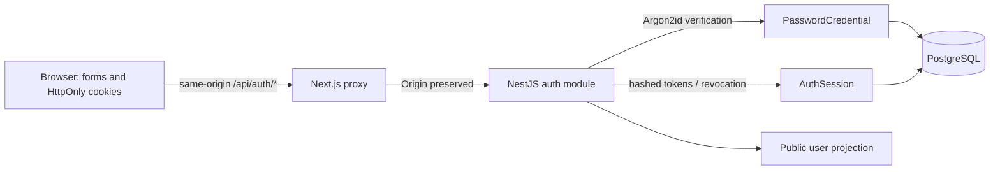

# Identity architecture

`AuthOriginGuard` checks mutations before handlers. `ValidationPipe` transforms
and validates DTOs and rejects unknown fields. `ThrottlerGuard` limits each
auth endpoint per direct caller IP. `SessionGuard` protects `/auth/me` by
checking a stored, unexpired, non-revoked access token. Neither cookie presence
in Next.js nor hidden UI controls authorize data access.

Register creates User and PasswordCredential atomically. Login does not trust
roles or tenant IDs from the request and creates an independent session family.
Refresh and logout serialize on the owning user row in PostgreSQL transactions,
so concurrent logout cannot leave a new successor active. Replay invalidation
commits before an HTTP 401 is raised. Revoked predecessor hashes remain available
for replay detection; implement bounded retention cleanup as a follow-up.

Login and password reset share that lock too. Reset commits the new credential,
email ownership proof, all-session revocation and outstanding email-action
invalidation together. A login using an old hash cannot race past revocation.

EmailAction stores purpose, expiry and SHA-256 digest, never the raw link. A
bounded two-worker background queue performs eligibility checks, issuance and
SMTP delivery after returning generic 202 responses. SMTP/account lookup timing
does not determine those responses. Production requires encrypted SMTP; Mailpit
captures fictional local/test messages without relaying them. The queue is not
durable; users resend after failure/restart. See [ADR 0002](../adr/0002-email-verification-and-recovery.md).

Next.js `/account` reads cookies only under Suspense; the browser loads the public
user from the API and renews expired access once. No per-user data is statically
rendered or cached; the build does not call the auth API. `/status` retains its
existing runtime health behavior. Browser tests run against dev mode so the
HTTP-only local test environment uses non-Secure development cookies; production
cookie flags and prefix are separately asserted in unit tests.

Token links use URL fragments, which do not reach web/proxy request logs, and
only explicit form POSTs consume them. Token pages use no-referrer/noindex and
remove the fragment after success. Login/logout navigate a new document after
cookie changes because a fetch through the API proxy does not invalidate the
Next.js Router Cache; an earlier unauthenticated redirect must not survive login.

Existing User, Organization and Membership records are retained. The migration
only adds nullable `emailVerifiedAt`, PasswordCredential and AuthSession. Legacy
users without credentials cannot log in until proving control through recovery.
No seed password or backfilled fake verification is created. The second migration
adds only EmailAction and its purpose enum/indexes/foreign key.

## Boundaries and pending work

Identity is personal, outside tenant scope. M2 adds verified-email-gated
organization creation/list/details/settings with server-validated memberships
and roles. Invitations and member mutations remain M3. PostgreSQL RLS is not
implemented. Unverified personal identity grants no tenant access. See
[organization boundaries](tenancy.md), the [roadmap](../roadmap.md) and
[session ADR](../adr/0001-authentication-and-sessions.md).
