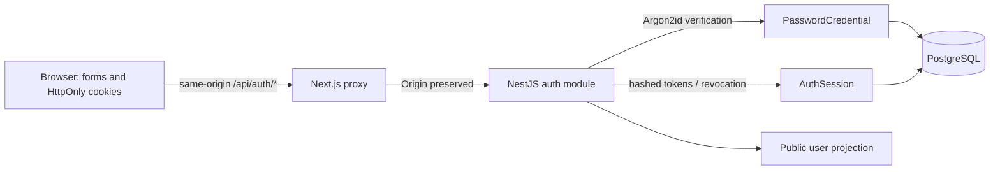

# Identity architecture

`AuthOriginGuard` checks mutations before handlers. `ValidationPipe` transforms
and validates DTOs and rejects unknown fields. `ThrottlerGuard` limits each
auth endpoint per direct caller IP. `SessionGuard` protects `/auth/me` by
checking a stored, unexpired, non-revoked access token. Neither cookie presence
in Next.js nor hidden UI controls authorize data access.

Register creates User and PasswordCredential atomically. Login does not trust
roles or tenant IDs from the request and creates an independent session family.
Refresh and logout serialize on the owning user row in PostgreSQL transactions,
so concurrent logout cannot leave a new successor active. Replay invalidation
commits before an HTTP 401 is raised. Revoked predecessor hashes remain available
for replay detection; implement bounded retention cleanup as a follow-up.

Next.js `/account` reads cookies only under Suspense; the browser loads the public
user from the API and renews expired access once. No per-user data is statically
rendered or cached; the build does not call the auth API. `/status` retains its
existing runtime health behavior. Browser tests run against dev mode so the
HTTP-only local test environment uses non-Secure development cookies; production
cookie flags and prefix are separately asserted in unit tests.

Existing User, Organization and Membership records are retained. The migration
only adds nullable `emailVerifiedAt`, PasswordCredential and AuthSession. Legacy
users without credentials cannot log in; the later verified recovery flow must
enroll them safely. No seed password or backfilled fake verification is created.

## Boundaries and pending work

Identity is personal, outside tenant scope. Organization, membership, invitations
and RBAC workflows remain planned. Shared-database tenant isolation will require
server-validated memberships in every organizational query; PostgreSQL RLS is
not implemented. The first slice neither grants tenant access nor claims that
unverified email is a proven identity. See the [roadmap](../roadmap.md) and
[session ADR](../adr/0001-authentication-and-sessions.md).
