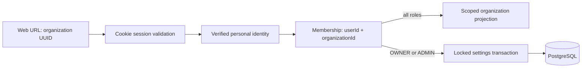
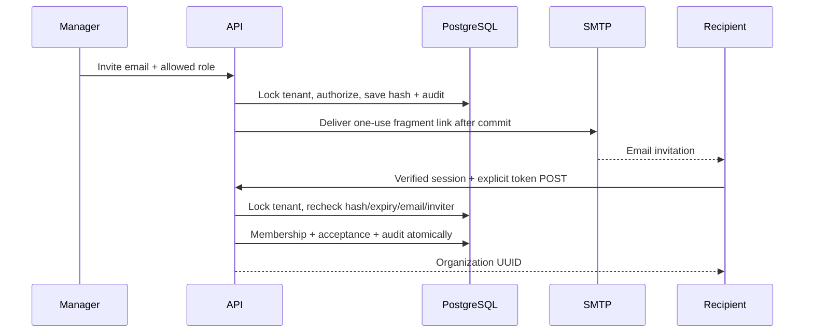

# Organization boundaries and RBAC

`OrganizationsModule` imports the existing authentication module. Every route uses
session, verified-email, Origin/JSON and request-limit guards. Personal identity
remains outside organization scope. No membership means 404 for organization
reads and writes, indistinguishable from a nonexistent UUID. Known members with
an insufficient role get 403. Unauthenticated users get 401; authenticated but
unverified identities get 403 even if a membership already exists.

| Implemented action | OWNER | ADMIN | MEMBER | VIEWER |
| --- | --- | --- | --- | --- |
| Read organization details | Yes | Yes | Yes | Yes |
| Update name/slug | Yes | Yes | No | No |
| List/search members, invitations and tenant audit | Yes | Yes | No | No |
| Invite/manage MEMBER and VIEWER | Yes | Yes | No | No |
| Invite/manage ADMIN | Yes | No | No | No |
| Transfer ownership to verified existing member | Yes | No | No | No |

Creation inserts the organization and its sole OWNER membership in one database
transaction. A foreign-key failure rolls back both. Slug uniqueness is enforced
by the existing database index; simultaneous collisions have one winner and a
409 loser, with no orphan organization. Slugs are canonical user-chosen strings
with explicit reserved names and no automatic suffixing (see ADR 0003).

Reads use the composite user/organization membership key and expose only the
public organization fields and caller's role. List queries always filter by the
authenticated user, with bounded pagination and stable membership ordering. The
new migration only indexes `(userId, createdAt, id)`; existing rows stay intact.

Settings writes take the organization-row lock, then read membership/role and
update the resource in the same transaction. Membership changes, transfers and
invitation operations take that same lock and persist audit in the transaction.
There is no global user role, implicit trusted tenant header,
or role claim accepted from a body. Membership removal/demotion applies on the
next request, regardless of the browser's last displayed role.

The web's active organization is the stable UUID in its URL. A selector changes
that URL and reloads scoped API data. Independent tabs can address different
tenants; changing a slug preserves bookmarks. Component remounts on UUID changes
and canceled load callbacks prevent an old request painting another tenant's
screen. All data requests and responses use no-store, and the API reauthorizes
every request even when client-side controls are hidden or stale.

## Limits and next work

This is application-enforced shared-database isolation, not PostgreSQL RLS.
Future tenant resources/exports/jobs/search must carry validated scope. Direct
database access bypasses the application and must be restricted operationally.
Organization deletion is not exposed. New organizations have one owner; M3
preserves this through explicit atomic transfer. Owner/self mutation is rejected
by member routes. Legacy zero/multiple owners cause transfer to fail for review;
no ownership data is silently changed. Direct SQL bypasses these application
policies and must not be used for routine membership administration.

## Invitation acceptance and management

Tokens have 256 bits of entropy, SHA-256 hashes and a 24-hour lifetime. Pending
invitations are unique per organization/normalized email through a partial SQL
index. Expiry is checked at use, not dependent on a scheduled job. Reissue rotates
the hash, expiry and authorized inviter. A removed/demoted inviter cannot grant
roles they no longer control. Membership already present is a conflict, never
an invitation-based promotion. A new account registers/verifies independently;
the link is reopened after sign-in and never saved in browser persistence.

The invitation page clears the fragment before identity requests, handles reopening
in the same tab and requires confirmation. Server GETs never consume invitations.
SMTP failures revoke only the affected generation and return safe 503, allowing
manual replacement; durable delivery and crash recovery remain limitations.

Member/invitation/audit lists require a manager role, default to 20 entries, cap
at 100 and offset 10,000. Member search stays inside the tenant. No public global
member search/count exists. Audit metadata is explicit (role changes, field names
and resource IDs); personal login/logout audit has null organization and is never
included in tenant reads. App routes do not update/delete audit records. This is
not a tamper-resistant external audit sink; retention remains operational work.

See [ADR 0003](../adr/0003-organizations-and-tenant-authorization.md) and the
[M3 ADR](../adr/0004-invitations-membership-and-audit.md), plus the
[OpenAPI contract](../api/openapi.yaml).
