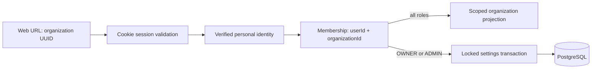

# Organization boundaries and RBAC

`OrganizationsModule` imports the existing authentication module. Every route uses
session, verified-email, Origin/JSON and request-limit guards. Personal identity
remains outside organization scope. No membership means 404 for organization
reads and writes, indistinguishable from a nonexistent UUID. Known members with
an insufficient role get 403. Unauthenticated users get 401; authenticated but
unverified identities get 403 even if a membership already exists.

| Implemented action | OWNER | ADMIN | MEMBER | VIEWER |
| --- | --- | --- | --- | --- |
| Read organization details | Yes | Yes | Yes | Yes |
| Update name/slug | Yes | Yes | No | No |

Creation inserts the organization and its sole OWNER membership in one database
transaction. A foreign-key failure rolls back both. Slug uniqueness is enforced
by the existing database index; simultaneous collisions have one winner and a
409 loser, with no orphan organization. Slugs are canonical user-chosen strings
with explicit reserved names and no automatic suffixing (see ADR 0003).

Reads use the composite user/organization membership key and expose only the
public organization fields and caller's role. List queries always filter by the
authenticated user, with bounded pagination and stable membership ordering. The
new migration only indexes `(userId, createdAt, id)`; existing rows stay intact.

Settings writes take the organization-row lock, then read membership/role and
update the resource in the same transaction. Future M3 membership mutations must
take that lock too. There is no global user role, implicit trusted tenant header,
or role claim accepted from a body. Membership removal/demotion applies on the
next request, regardless of the browser's last displayed role.

The web's active organization is the stable UUID in its URL. A selector changes
that URL and reloads scoped API data. Independent tabs can address different
tenants; changing a slug preserves bookmarks. Component remounts on UUID changes
and canceled load callbacks prevent an old request painting another tenant's
screen. All data requests and responses use no-store, and the API reauthorizes
every request even when client-side controls are hidden or stale.

## Limits and next work

This is application-enforced shared-database isolation, not PostgreSQL RLS.
Future tenant resources/exports/jobs/search must carry validated scope. Direct
database access bypasses the application and must be restricted operationally.
M2 exposes no member mutations or organization deletion. New organizations have
one owner; M3 will implement audited ownership transfer/last-owner invariants and
invitations with concurrency tests. No legacy ownership data is silently changed.

See [ADR 0003](../adr/0003-organizations-and-tenant-authorization.md) and the
[OpenAPI contract](../api/openapi.yaml).
