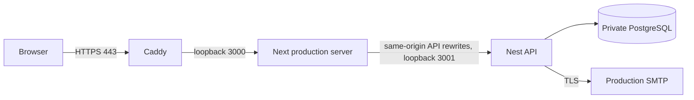

# HTTPS deployment preparation

Status: a deployment procedure and validated proxy configuration are provided.
No host, DNS, certificate, external SMTP or public demo has been provisioned.
Public publication is explicitly deferred by the maintainer. Local/CI acceptance
does not establish public production readiness.

## Single-host topology



Use an unprivileged app account, Node 24 and the lockfile's pnpm version. Only
HTTPS/HTTP redirect ports are public. Bind Next with `--hostname 127.0.0.1` and
API with `API_HOST=127.0.0.1` (the default). Restrict PostgreSQL to the app's private
network; never deploy Compose demo/test passwords or expose Mailpit. `0.0.0.0`
is an explicit API option for container networks only, with network restrictions.

Configure protected process-manager environment files, outside Git, for:

- API: production DATABASE_URL with least privileges, NODE_ENV=production,
  API_HOST=127.0.0.1, PORT=3001, exact `WEB_ORIGIN=https://your-domain`.
- SMTP: explicit SMTP_HOST/FROM/PORT and TLS (`SMTP_REQUIRE_TLS=true` on 587 or
  `SMTP_SECURE=true` on 465), and paired USER/PASSWORD when required. Use a real
  verified sender; Mailpit is only for local/test captures.
- Web build/runtime: API_URL=http://127.0.0.1:3001, NODE_ENV=production.
  API_URL is used during Next build for rewrites; set it before building.
- Caddy: TENANTCORE_DOMAIN set to the chosen bare DNS name. DNS/ACME reachability,
  certificate storage/renewal and firewall rules belong to the selected host.

## Release procedure

On a staging host first, with the correct protected environment already loaded:

```sh
pnpm install --frozen-lockfile
pnpm --filter api exec prisma generate
pnpm lint
pnpm typecheck
pnpm test
pnpm build
pnpm --filter api exec prisma migrate deploy
```

Take/verify a database backup before applying migrations. Run migrations once as
a release step, never concurrently on each app boot. Keep SQL-only constraints
from M3 migrations intact. Production never invokes the demo seed.

Run these under the host's process manager with restart/shutdown/log retention:

```sh
pnpm --filter api start:prod
pnpm --filter web start --hostname 127.0.0.1 -p 3000
```

Use `deploy/Caddyfile`; validate it with Caddy 2.11.7 (also checked in CI), then
install/reload it through the selected host's normal service procedure. Validation
does not request a certificate or prove DNS/HTTPS reachability. The proxy forwards
to Next, preserving its same-origin cookie and Origin behavior. Preserve route-
specific no-referrer/no-store headers for token pages; disable raw access logging
of token bodies, authorization headers and cookies at every upstream layer.

Verify internal `/live` and `/ready`, then external `/status`, real register/
verification/login/refresh/logout/recovery, the production `__Host-` Secure
HttpOnly SameSite cookies and Origin rejection, a two-account invitation journey
and cross-tenant denial. Record actual release SHA and HTTPS URL only after this
passes; this repository does not claim those host checks have run.

## Operational limits before a public demonstration

The current API throttler is in-process and sees the Next proxy's loopback IP.
Several visitors can share one quota. Do not blindly trust forwarded headers:
choose/configure a trusted ingress and edge abuse limits before opening access.
Horizontal scaling additionally needs shared rate-limit storage. These production
changes require the chosen host's trust topology and are not enabled speculatively.
Set demonstration access limits and use only fictitious, disposable data. Do not
publish reusable shared owner credentials; choose per-evaluator enrollment or
another reviewed restricted access policy.

Account mail queue is bounded/in-memory; invitations await SMTP and compensate
failures. A durable encrypted outbox/retry policy, retention cleanup for revoked
sessions/tokens/audit and backup restoration drills remain operational work.
Request logs intentionally omit exception bodies/stacks and user data; correlate
`X-Request-Id` with route/status/error events and reproduce diagnostics in a
restricted staging environment. Do not enable raw Prisma query logging in public.

If a release fails, stop traffic, return app processes to the previous tested
release and retain additive schema/data. Do not automatically drop tables or run
`db push`/`migrate reset`; use a reviewed forward migration or tested restore plan.

Reference: [Caddy reverse proxy](https://caddyserver.com/docs/caddyfile/directives/reverse_proxy).
